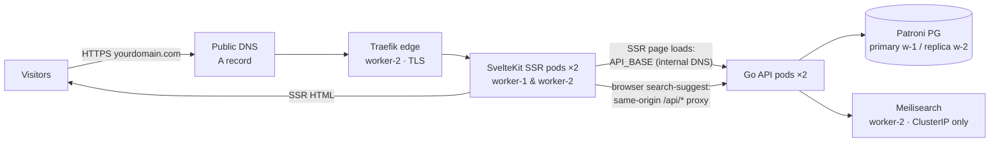
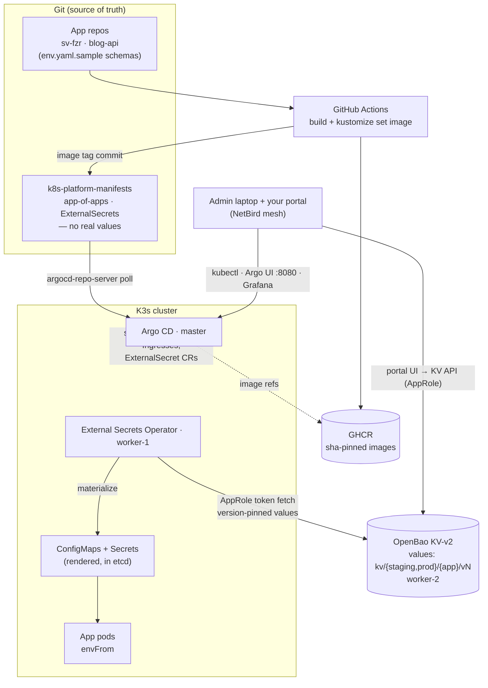

# PRODUCTION-GRADE K3s INFRASTRUCTURE BLUEPRINT & SETUP GUIDE

## 1. Architecture & Cost Sourcing

### Infrastructure Topology
* **Master Node (Control Plane):** 1x **Biznet Gio NEO Lite SS 2.2**
  * **Resources:** 2 vCPU / 2 GB RAM / 60 GB SSD
  * **Cost:** IDR 109,000 / month (~$7 USD)
  * **Workloads:** K3s Control Plane (`kube-apiserver`, `etcd`/`Kine`), Argo CD Engine (all components), NetBird Agent.

* **Worker Node 1 (Data & Observability Backbone):** 1x **Biznet Gio NEO Lite MS 4.2**
  * **Resources:** 2 vCPU / 4 GB RAM / 60 GB SSD
  * **Cost:** IDR 139,000 / month (~$8.80 USD)
  * **Workloads:** Patroni PostgreSQL (Primary), Grafana LGTM data plane (Loki, VictoriaMetrics, Alloy), Go Application Instance 1, SvelteKit Frontend Instance 1, External Secrets Operator, NetBird Agent.

* **Worker Node 2 (Search, Replica & Traffic):** 1x **Biznet Gio NEO Lite MS 4.2**
  * **Resources:** 2 vCPU / 4 GB RAM / 60 GB SSD
  * **Cost:** IDR 139,000 / month (~$8.80 USD)
  * **Workloads:** Patroni PostgreSQL (Replica), Meilisearch, Grafana UI, Go Application Instance 2, SvelteKit Frontend Instance 2, Traefik Ingress Edge Router, cert-manager, OpenBao (secrets/config store), NetBird Agent.

* **Total Monthly Investment:** **IDR 387,000 / month** (~$24–$25 USD/mo).

* **Networking:** node↔node traffic rides either a **GIO VPC** (Path A, preferred — if
  available on NEO Lite; verify at rental per Phase 1) or the **NetBird mesh** (Path B).
  NetBird is always the admin plane. Full decision table: Phase 2.

### Node Resource Budget (requests / limits)

Memory limits must stay **below** allocatable RAM (node OS + kubelet reserve ~500–700 MB).
`local-path` provisioner (K3s bundled) serves all PVCs; disk sizing below assumes 60 GB SSD.

| Workload | Node | Requests | Limits | PVC (approx) |
| :--- | :--- | :--- | :--- | :--- |
| K3s control plane | master | system | ~500 Mi | — |
| Argo CD (all 7 components) | master | 350m/800Mi total | 1 CPU/1.6Gi total | 2 Gi (`/tmp` repos) |
| Patroni PostgreSQL (Primary) | worker-1 | 250m/512Mi | 1 CPU/1Gi | 10 Gi |
| Patroni PostgreSQL (Replica) | worker-2 | 250m/512Mi | 1 CPU/1Gi | 10 Gi |
| Loki | worker-1 | 200m/512Mi | 500m/800Mi | 15 Gi (7d retention) |
| VictoriaMetrics | worker-1 | 200m/384Mi | 500m/512Mi | 10 Gi |
| Grafana Alloy | worker-1 | 100m/128Mi | 300m/256Mi | — |
| Grafana UI | worker-2 | 100m/128Mi | 300m/256Mi | 1 Gi |
| Meilisearch | worker-2 | 200m/384Mi | 500m/700Mi | 5 Gi |
| Go API (2 instances) | worker-1 & 2 | 100m/128Mi each | 300m/256Mi each | — |
| SvelteKit SSR frontend (2 instances) | worker-1 & 2 | 100m/192Mi each | 300m/384Mi each | — |
| OpenBao (secrets/config plane) | worker-2 | 100m/160Mi | 300m/320Mi | 1 Gi (file storage) |
| External Secrets Operator | worker-1 | 50m/128Mi | 200m/256Mi | — |
| Traefik + cert-manager | worker-2 | 100m/128Mi | 300m/256Mi | — |

> Master fit: requests (~500 Mi K3s + ~800 Mi Argo ≈ 1.3 Gi) fit inside the ~1.4 Gi
> allocatable on a 2 GB node; Argo *limits* intentionally oversubscribe (real usage is
> bursty). The 2 GB swapfile added in Phase 2 is the OOM backstop — not optional.
>
> **Anti-affinity rule:** Patroni Primary and Replica must never co-schedule. Zalando's
> operator enforces hostname pod-anti-affinity by default; the same rule is set explicitly
> in the Go API and SvelteKit frontend `deployment.yaml` files (2 replicas, 2 workers).

### Component & Data-Flow Diagrams

**Data plane — what a visitor's request touches:**



Everything right of Traefik is cluster-internal. The **only public entrypoint** is the
frontend ingress; the API and Meilisearch have no ingress at all (§2).

**Control plane — how the cluster is driven (GitOps + secrets):**



Reading guide:
0. **Node network:** all traffic *between the three nodes* (API, pod overlay, replication)
   rides the private plane chosen in Phase 2 — Path A (GIO VPC) or Path B (mesh). NetBird
   *always* serves the laptop→cluster admin path regardless of that choice.
1. **Ship code:** push app repo → CI builds image to GHCR and commits the new tag into the manifests repo.
2. **Sync:** Argo (watching the manifests repo) applies the diff; `prune + selfHeal` keeps the cluster honest.
3. **Config/secret render:** Argo applies `ExternalSecret` templates; ESO pulls the *values* from OpenBao (version-pinned per environment overlay) and materializes in-cluster ConfigMaps/Secrets that pods read as env.
4. **Admin:** everything managed via the NetBird mesh — no public admin endpoints; your portal edits OpenBao through its REST API (§5).
5. **Bootstrap exception:** Argo itself, the age/offline seeds, and OpenBao's root/unseal setup are applied manually once (§5.6, §6).

---

## 2. Network Security & Access Matrix

| Service | Access Level | Endpoint / Route | Protocol / Security Layer |
| :--- | :--- | :--- | :--- |
| **Blog Frontend (SvelteKit SSR)** | **Public** | `yourdomain.com` | HTTPS via Traefik Ingress + Let's Encrypt TLS (HTTP→HTTPS redirect enforced) |
| **Go API** | **Cluster-internal only** | `http://blog-backend.blog-backend.svc.cluster.local` | No public ingress. SSR pods call it directly; the browser's single client-side call (search suggest) rides the frontend's same-origin `/api/...` proxy |
| **Argo CD Control Panel** | **Private (VPN Only)** | `localhost:8080` (Port-forwarded) / Private Ingress | Private NetBird WireGuard Overlay Mesh |
| **Grafana / VictoriaMetrics / Loki** | **Private (VPN Only)** | Internal Mesh DNS / Local Tunnel | Private NetBird WireGuard Overlay Mesh |
| **Meilisearch** | **Cluster-internal only** | `http://meilisearch.search.svc.cluster.local:7700` | No public or mesh ingress; API-only access |
| **OpenBao (config/secrets store)** | **Cluster-internal + admin API** | `http://bao.secrets.svc.cluster.local:8200` | AppRole/periodic tokens; built-in UI mesh-only behind Traefik private route; never public |
| **External Secrets Operator** | **Cluster-internal only** | `eso-controller.external-secrets.svc` | Watches ExternalSecret CRs, writes rendered objects; no ingress |
| **K3s Control Plane API (`:6443`)** | **Private (VPC + VPN mesh)** | Path A: `https://<MASTER_VPC_IP>:6443` (nodes) + `https://<MASTER_NETBIRD_IP>:6443` (laptop) · Path B: mesh only | Dual `--tls-san`; public exposure never (ufw/SG-restricted per Phase 2.4) |
| **Node Terminal Access (SSH)** | **Private (VPN Only)** | `ssh <USER>@<NETBIRD_NODE_IP>` | NetBird mesh SSH (Port 22 closed publicly; root login disabled after mesh SSH verified) |

> **Note on NetBird "Keyless SSO SSH":** identity-aware keyless SSH requires the **NetBird Enterprise plan or a self-hosted NetBird server with SSO configured**. On the free plan, SSH over the mesh still works with normal key authentication — the security model above (public port 22 closed, mesh-only) is unaffected.

---

## 3. DNS Architecture Strategy

### A. Public Domain DNS (For External Users)
Managed via your external DNS provider (Cloudflare, Namecheap, Route53, etc.):
* **A Record:** `yourdomain.com` ➔ `[Biznet Gio Public IP]`
* **Wildcard CNAME / A Record:** `*.yourdomain.com` ➔ `[Biznet Gio Public IP]`
* **Routing:** Traefik Ingress receives traffic on ports 80/443 and terminates SSL via `cert-manager` (ACME HTTP-01 challenge).
* **Ordering constraint:** public DNS records must resolve to all node IPs (or the egress node running Traefik) **before** first certificate issuance, or HTTP-01 solvers will fail.

### B. Internal Cluster DNS (Automatic via K3s)
* Managed out-of-the-box by **CoreDNS** inside the cluster.
* Microservices communicate dynamically using Kubernetes internal service endpoints (e.g., `blog-pg-postgres.db.svc.cluster.local:5432` for reads/writes, `blog-pg-repl.db.svc.cluster.local` for read-only).

### C. Private VPN Mesh DNS (Automatic via NetBird)
* Managed by **NetBird Magic DNS**.
* Connects your local machine and nodes seamlessly using hostname aliases (`master-node`, `worker-1`, `worker-2`) without editing local `/etc/hosts` files or running custom BIND servers.
* **Scope note:** under Path A (Phase 2), Magic DNS is admin-plane only (laptop → cluster); node↔node name resolution uses the VPC. Hostnames still resolve everywhere a NetBird client runs.

---

## 4. Phase-by-Phase Execution Guide

### Phase 0: Local Rehearsal (recommended before renting)

Run the full k3d drill from [`README.md`](README.md) §2–5 — placement, failover, GitOps
sync — so Phases 1–9 on real hardware are a repeat of something already proven. Nothing
in this phase touches the VPS.

### Phase 1: Provisioning & NetBird Mesh Setup

> **What lives where after this phase:** NetBird is the **admin plane only** — laptop ⇄
> cluster (kubectl, Argo UI, SSH). Node↔node cluster traffic follows the **network path
> chosen in Phase 2** (Path A: GIO VPC, Path B: mesh). Keep that mental model; the
> install commands below are written for both.

0. **Rent the VPS instances (Biznet GIO console):**
   * Create the three instances per §1 (Path A decision may add a 4th — see Phase 2),
     Ubuntu 24.04 image, upload your SSH public key, record public IPs + private (VPC) IPs.
   * **VPC verification checklist** (do this now — it decides Phase 2's path, and it's
     cheap to check before renting the rest):
     - [ ] VPC ("Virtual Network") available on NEO Lite SS/MS tiers? Price per attachment?
     - [ ] Attach all nodes to one VPC/subnet; confirm inter-node `ping <peer-vpc-ip>` works
     - [ ] Identify the interface inside Ubuntu: `ip a` — note the NIC name (`eth1`, `ens6`…)
           and its MTU (`ip link show <if>`) → becomes `<VPC_IFACE>` / `<VPC_MTU>` below
     - [ ] Are VPC IPs **static per instance** (survive rebuild/reboot)? If not → Path B.
     - [ ] Routing: `ip route` — is the VPC subnet routed via the second NIC only?
     - [ ] Security Groups: can inbound 6443/10250 be allowlisted to the VPC CIDR?
   * Lock down early via console firewall/SG or `ufw` on each node:
     ```bash
     ufw default deny incoming
     ufw allow 22/tcp   # tightened to mesh-only once NetBird works (step 4)
     # 80/443 only on worker-2, once Traefik exists (Phase 3)
     ufw enable
     ```

1. **Install NetBird Agent on All Nodes (Master, Worker 1, Worker 2):**
   ```bash
   curl -fsSL https://pkgs.netbird.io/install.sh | sh
   ```

2. **Authenticate Nodes to NetBird Network:**
   ```bash
   sudo netbird up --setup-key <YOUR_NETBIRD_SETUP_KEY>
   ```

3. **Enable SSH over the Mesh:**
   ```bash
   # Enterprise / self-hosted NetBird with SSO (identity-aware keyless SSH):
   sudo netbird up --ssh=true
   # Free plan: standard key-based SSH over the wt0 interface — no extra flag needed.
   ```

4. **Verify Connectivity from Local Machine:**
   Ensure NetBird client is active on your laptop, then verify access:
   ```bash
   ssh <USER>@<master-node-netbird-ip>
   ```

---

### Phase 2: K3s Cluster Bootstrap

> **Decision — which network carries the cluster?** Both paths are supported; the
> rent-time findings from the Phase 1 checklist choose it.
>
> | | **Path A — GIO VPC carries cluster traffic** (preferred if available) | **Path B — NetBird mesh carries cluster traffic** (fallback) |
> | :--- | :--- | :--- |
> | Node↔node: API, flannel, replication | VPC private IPs, provider-managed | `wt0` overlay IPs |
> | Mesh role | admin plane only (laptop→cluster) | admin **and** data plane |
> | NetBird down ⇒ | cluster unaffected (admin only) | agents crash-loop, nodes go NotReady |
> | Latency/MTU | native VPC MTU (match flannel MTU if <1500) | tunnel-capped, +1 hop |
> | 6443 exposure | VPC CIDR only (SG/ufw allowlist) | mesh CIDR only |
> | Extra deps | none | systemd `Requires=netbird` ordering below |
> | Staticity risk | VPC IP changes on rebuild ⇒ cert reissue | overlay IPs stable across rebuilds |
>
> Placeholders: `<MASTER_VPC_IP>`, `<VPC_IFACE>` (from Phase 1 checklist), `<MASTER_NETBIRD_IP>`.
> K3s accepts multiple `--tls-san` flags — **both paths pin BOTH addresses** below, so
> kubectl and break-glass access work over either plane no matter which carries traffic.

> **Host prep (run on ALL nodes before installing K3s).** The 2 GB master is the tightest
> box in the cluster; a swapfile is its OOM backstop, and `vm.max_map_count` is required
> for the search/observability workloads:
>
> ```bash
> # 2 GB emergency swap (all nodes)
> sudo fallocate -l 2G /swapfile && sudo chmod 600 /swapfile
> sudo mkswap /swapfile && sudo swapon /swapfile
> echo '/swapfile none swap sw 0 0' | sudo tee -a /etc/fstab
> # Search/VM index workloads (workers especially, but harmless everywhere)
> echo "vm.max_map_count=262144" | sudo tee /etc/sysctl.d/99-search.conf
> sudo sysctl --system
> ```
>
> Because swap is enabled, K3s must be told not to fail on it: every install command below
> passes `--kubelet-arg=failSwapOn=false`.

> **Prerequisite — systemd ordering (Path B only):** when the mesh carries cluster
> traffic, workers dial the API over NetBird, and if NetBird isn't up before K3s starts
> after a reboot, `k3s-agent` crash-loops. Apply this override on **all nodes** before
> installing K3s. On Path A skip the `Requires=`/`After=` lines (keep `systemctl enable
> netbird` for admin access):
>
> ```bash
> sudo mkdir -p /etc/systemd/system/k3s.service.d /etc/systemd/system/k3s-agent.service.d
> # Master (server unit):
> sudo tee /etc/systemd/system/k3s.service.d/netbird.conf <<'EOF'
> [Unit]
> After=netbird.service
> Requires=netbird.service
> EOF
> # Workers (agent unit) — same content:
> sudo tee /etc/systemd/system/k3s-agent.service.d/netbird.conf <<'EOF'
> [Unit]
> After=netbird.service
> Requires=netbird.service
> EOF
> sudo systemctl daemon-reload
> ```

1. **Initialize Master Node (Control Plane):**
   SSH into the Master node (over the mesh — that works regardless of path) and run,
   **Path A (VPC)**:
   ```bash
   curl -sfL https://get.k3s.io | INSTALL_K3S_EXEC="server \
     --disable=traefik \
     --tls-san=<MASTER_VPC_IP> \
     --tls-san=<MASTER_NETBIRD_IP> \
     --flannel-iface=<VPC_IFACE> \
     --kubelet-arg=failSwapOn=false \
     --node-name=master-node" sh -s -
   ```
   **Path B (mesh)**:
   ```bash
   curl -sfL https://get.k3s.io | INSTALL_K3S_EXEC="server \
     --disable=traefik \
     --tls-san=<MASTER_NETBIRD_IP> \
     --flannel-iface=wt0 \
     --kubelet-arg=failSwapOn=false \
     --node-name=master-node" sh -s -
   ```
   > `--flannel-iface` pins the pod overlay to the chosen private interface; without it,
   > flannel can bind to the public NIC on multi-interface nodes and break pod CIDR routing.
   > Pinning both `--tls-san`s keeps kubeconfig valid over either plane (and is the
   > break-glass escape if the chosen plane misbehaves — flip `--flannel-iface`, traffic
   > follows, certs already cover it).

2. **Retrieve K3s Join Token:**
   ```bash
   sudo cat /var/lib/rancher/k3s/server/node-token
   ```

3. **Join Worker Nodes:**
   Run on **Worker 1**:
   ```bash
   curl -sfL https://get.k3s.io | K3S_URL="https://<MASTER_API_IP>:6443" \
     K3S_TOKEN="<NODE_TOKEN_FROM_MASTER>" \
     INSTALL_K3S_EXEC="agent --node-name=worker-1 --flannel-iface=<CLUSTER_IFACE> --kubelet-arg=failSwapOn=false" sh -s -
   ```
   Run on **Worker 2**: same command with `--node-name=worker-2`.
   Where (per chosen path): `Path A → <MASTER_API_IP>=<MASTER_VPC_IP>, <CLUSTER_IFACE>=<VPC_IFACE>` ·
   `Path B → <MASTER_API_IP>=<MASTER_NETBIRD_IP>, <CLUSTER_IFACE>=wt0`.

4. **Verify Cluster Health (and reboot-test the chosen path):**
   ```bash
   kubectl get nodes -o wide
   # Confirm INTERNAL-IP column shows VPC (Path A) or wt0 (Path B) addresses —
   # a public IP there means flannel-iface didn't take.
   # Reboot one worker and confirm k3s-agent comes up cleanly:
   sudo reboot
   ```
   Path A additionally: lock the control-plane ports to the private plane once verified:
   ```bash
   # on all nodes — 6443/10250 reachable only from the VPC subnet (+ mesh CIDR for laptop kubectl)
   ufw allow in on <VPC_IFACE> to any port 6443,10250 proto tcp
   ufw deny 6443,10250/tcp
   ```

5. **Label Nodes for Placement (used by GitOps overlays in later phases):**
   ```bash
   kubectl label node master-node node-pool=platform
   kubectl label node worker-1    node-pool=data
   kubectl label node worker-2    node-pool=edge
   ```

---

### Phase 3: Ingress Controller (Traefik) & cert-manager

> K3s's bundled Traefik was disabled in Phase 2. This phase installs the edge router and
> certificate automation referenced by §1–§3. Both are deployed **as GitOps-managed
> manifests/Charts in the `k8s-platform-manifests` repo** (see Phase 6), applied here
> manually only for the first bring-up.

1. **Install Traefik (Helm), pinned to worker-2 (`node-pool=edge`):**
   ```bash
   helm repo add traefik https://traefik.github.io/charts
   helm repo update
   helm install traefik traefik/traefik -n ingress --create-namespace \
     --set nodeSelector.node-pool=edge \
     --set service.externalTrafficPolicy=Local \
     --set providers.kubernetesCRD.enabled=true \
     --set "ports.web.redirectTo=websecure" \
     --set "ports.websecure.tls.enabled=true"
   ```

2. **Install cert-manager + Let's Encrypt ClusterIssuer:**
   ```bash
   # Pin an exact release — `latest/download` can drift underneath a running cluster.
   kubectl apply -f https://github.com/cert-manager/cert-manager/releases/download/v1.16.2/cert-manager.yaml
   kubectl -n cert-manager wait --for=condition=Available deploy/cert-manager --timeout=180s
   kubectl apply -f - <<'EOF'
   apiVersion: cert-manager.io/v1
   kind: ClusterIssuer
   metadata:
     name: letsencrypt-prod
   spec:
     acme:
       server: https://acme-v02.api.letsencrypt.org/directory
       privateKeySecretRef: { name: letsencrypt-prod-account-key }
       solvers:
         - http01:
             ingress: { class: traefik }
   EOF
   ```
   > cert-manager pods get `nodeSelector: { node-pool: edge }` via the GitOps overlay.
   > Ensure §3A DNS records already resolve, or the first HTTP-01 challenge fails.

---

### Phase 4: Data Layer — Patroni PostgreSQL, Meilisearch, Storage

1. **Storage:** K3s's bundled `local-path` provisioner is the default StorageClass.
   Verify: `kubectl get sc`. Set PVC sizes per the §1 budget table.

2. **Patroni PostgreSQL — DCS/quorum design (read before deploying):**
   Patroni needs an external DCS with leader-election quorum. Two designs, one trap:

   * **Trap:** a 2-member etcd DCS (one peer per worker) has *no* failure tolerance —
     losing either node loses quorum and no leader can be elected.
   * **Recommended path (used here):** deploy **Zalando's Postgres Operator**
     (`acid.zalan.do`). Its clusters run Patroni with **Kubernetes as the DCS**
     (leader locks live in K3s itself), so there is no separate etcd to operate. The honest
     tradeoff: if the K3s control plane is down, Patroni cannot renew its lock and enters
     *fail-safe mode* (the running primary keeps serving; no promotion until the API
     recovers). Since K3s on the single master is already the cluster's biggest SPOF, this
     adds no new failure domain at blog scale.
   * **Alternative:** self-hosted Patroni with a real 3-member etcd DCS (full peers on
     both workers + a voter-only peer on the master, ~128 Mi). Only worth it if you move
     the control plane to HA later.

   Application `postgresql` CR (Primary/Replica split across nodes):
   ```yaml
   apiVersion: 'acid.zalan.do/v1'
   kind: postgresql
   metadata:
     name: blog-pg
     namespace: db
   spec:
     teamId: 'blog'
     volume: { size: 10Gi, storageClass: 'local-path' }
     numberOfInstances: 2
     node_affinity:                      # keep DB pods off the 2 GB master
       matchExpressions:
         - key: node-pool
           operator: In
           values: ['data', 'edge']
     patroni:
       initdb: { encoding: 'UTF8', data-checksums: 'true' }
       ttl: 30
       loop_wait: 10
       retry_timeout: 10
       synchronous_mode: 'false'
     resources:
       requests: { cpu: '250m', memory: '512Mi' }
       limits:   { cpu: '1000m', memory: '1Gi' }
     databases: { blog_prod: db_user }
   ```
   > The operator spreads the two replicas across hosts with built-in pod anti-affinity
   > and creates `blog-pg-postgres` (read/write) + `blog-pg-repl` (read-only) Services.

   Deploy the operator first (pinned release), then the CR via GitOps:
   ```bash
   kubectl apply -f https://raw.githubusercontent.com/zalando/postgres-operator/v1.13.0/manifests/operator-manifests.yaml
   ```

3. **Meilisearch (namespace `search`), internal-only:**
   * Deployment with `nodeSelector: { node-pool: edge }`, PVC 5 Gi, `MEILI_DB_PATH=/data`.
   * `Service` type `ClusterIP` only — **no IngressRoute, no NodePort**. The Go API reaches it
     at `http://meilisearch.search.svc.cluster.local:7700` with an API key from a Secret.

4. **Host OS tuning:** `vm.max_map_count` and the swapfile were applied to all nodes in the
   Phase 2 host-prep step — no additional per-node tuning needed here.

---

### Phase 5: Observability — Grafana LGTM

* **worker-1 (`node-pool=data`):** Loki (15 Gi PVC, 7-day retention), VictoriaMetrics (10 Gi), Grafana Alloy (scrape/log shipper).
* **worker-2 (`node-pool=edge`):** Grafana UI (1 Gi PVC), datasources pointed at Loki/VM **service DNS** (`http://loki.observability.svc.cluster.local:3100`, `http://victoria-metrics.observability.svc.cluster.local:8428`).
* All observability `IngressRoute`s are **mesh-private** (NetBird-only, basic-auth or none — never exposed publicly), per §2.
* Apply the resource requests/limits from the §1 budget table verbatim. Loki's `-store.tsdb.max-block-duration` and retention config live in its Git manifest, since a misconfigured Loki will fill the 60 GB disk first.

---

### Phase 6: Argo CD Installation (as GitOps) & Master Node Isolation

> Argo CD is installed **declaratively**: a kustomize overlay of the upstream manifests,
> committed to `k8s-platform-manifests/platform/argocd/`. Manual `kubectl patch` calls are
> impermanent (wiped by re-apply/upgrade) and defeat the GitOps story.

1. **Repository structure for Argo CD's own install:**
   ```text
   platform/argocd/
   ├── kustomization.yaml         # pinned upstream install.yaml + patches
   ├── pinning-patch.yaml         # JSON6902 nodeSelector { node-pool: platform } applied by
   │                               #   labelSelector app.kubernetes.io/part-of=argocd to EVERY
   │                               #   Argo Deployment + StatefulSet (future components included)
   └── resources-patches.yaml     # per-component requests/limits: server, repo-server,
                                   #   application-controller, redis, dex-server,
                                   #   notifications-controller, applicationset-controller
   ```
   The overlay must cover **all** components — pinning only server/repo/controller leaves
   redis, dex, notifications and applicationset floating onto worker nodes.

2. **Apply once (self-hosting bootstrap):**
   ```bash
   kubectl apply -k platform/argocd/
   ```

3. **Fetch Initial Admin Credentials — and dispose of them:**
   ```bash
   kubectl -n argocd get secret argocd-initial-admin-secret -o jsonpath="{.data.password}" | base64 -d
   # After first login: change the password (or switch to Dex SSO / RBAC tokens), then:
   kubectl -n argocd delete secret argocd-initial-admin-secret
   ```

---

### Phase 7: Multi-Tenant GitOps Structure ("App-of-Apps" Pattern)

> **Layout fix:** the hub points at `apps/`, which must contain **`Application` CRs**, not
> raw resources. Each per-app Application declares its own destination namespace.

Repository layout for `k8s-platform-manifests` (a working scaffold lives in
[`k8s-platform-manifests/`](k8s-platform-manifests/) in this project — see
[README.md](README.md) for running it locally):

```text
k8s-platform-manifests/
├── bootstrap/
│   └── apps-hub.yaml              # root Application → path: apps/, recurse: false
├── apps/                          # Application definitions ONLY
│   ├── blog-frontend-app.yaml
│   ├── blog-backend-app.yaml
│   ├── blog-db-app.yaml
│   └── ...                        # (argocd itself stays bootstrapped manually in Phase 6)
├── applications/                  # raw manifests, one dir per app
│   ├── blog-frontend/             # SvelteKit SSR site (repo: sv-fzr, adapter-node)
│   │   ├── kustomization.yaml     # CI updates the image via `kustomize edit set image`
│   │   ├── namespace.yaml
│   │   ├── deployment.yaml
│   │   ├── service.yaml
│   │   └── ingress.yaml
│   ├── blog-backend/
│   │   ├── kustomization.yaml     # CI updates the image via `kustomize edit set image`
│   │   ├── namespace.yaml
│   │   ├── deployment.yaml
│   │   └── service.yaml           # ClusterIP only — no Ingress (API is internal)
│   └── blog-db/
│       ├── kustomization.yaml
│       ├── namespace.yaml
│       └── postgresql.yaml        # Zalando postgresql CR (Phase 4)
└── platform/
    └── argocd/                    # Phase 6 overlay (pinned upstream + selector patches)
        ├── kustomization.yaml
        ├── pinning-patch.yaml
        └── resources-patches.yaml
```

`bootstrap/apps-hub.yaml`:
```yaml
apiVersion: argoproj.io/v1alpha1
kind: Application
metadata:
  name: platform-apps-hub
  namespace: argocd
spec:
  project: default
  source:
    repoURL: 'https://github.com/yourusername/k8s-platform-manifests.git'
    targetRevision: HEAD
    path: apps/
    directory:
      recurse: false
  destination:
    server: 'https://kubernetes.default.svc'
    namespace: argocd
  syncPolicy:
    automated:
      prune: true
      selfHeal: true
```

`apps/blog-backend-app.yaml` (example):
```yaml
apiVersion: argoproj.io/v1alpha1
kind: Application
metadata:
  name: blog-backend
  namespace: argocd
spec:
  project: default
  source:
    repoURL: 'https://github.com/yourusername/k8s-platform-manifests.git'
    targetRevision: HEAD
    path: applications/blog-backend
  destination:
    server: 'https://kubernetes.default.svc'
    namespace: blog-backend
  syncPolicy:
    automated: { prune: true, selfHeal: true }
```

Apply once:
```bash
kubectl apply -f bootstrap/apps-hub.yaml
```

---

### Phase 8: GitHub Actions CI/CD Pipeline

> **Fixes vs. old draft:** `sed 's|image:.*|…|g'` rewrote **every** image line (sidecars,
> init containers). We now use `kustomize edit set image` against the deployment's kustomization,
> guard the commit against no-diff runs, and pin a single tag scheme (`sha-<short>`; `latest`
> is not deployed).

`.github/workflows/deploy.yml` in your application source repository:

```yaml
name: CI/CD Pipeline

on:
  push:
    branches: [ main ]

env:
  REGISTRY: ghcr.io
  IMAGE_NAME: ${{ github.repository }}

jobs:
  build-and-push:
    runs-on: ubuntu-latest
    permissions:
      contents: read
      packages: write
    outputs:
      version: ${{ steps.meta.outputs.version }}

    steps:
      - name: Checkout Code
        uses: actions/checkout@v4

      - name: Log in to GHCR
        uses: docker/login-action@v3
        with:
          registry: ${{ env.REGISTRY }}
          username: ${{ github.actor }}
          password: ${{ secrets.GITHUB_TOKEN }}

      - name: Extract Metadata
        id: meta
        uses: docker/metadata-action@v5
        with:
          images: ${{ env.REGISTRY }}/${{ env.IMAGE_NAME }}
          tags: |
            type=sha,prefix=sha-,format=short

      - name: Build and Push Image
        uses: docker/build-push-action@v5
        with:
          context: .
          push: true
          tags: ${{ steps.meta.outputs.tags }}
          labels: ${{ steps.meta.outputs.labels }}

  update-manifests:
    needs: build-and-push
    runs-on: ubuntu-latest
    steps:
      - name: Checkout Manifests Repo
        uses: actions/checkout@v4
        with:
          repository: 'yourusername/k8s-platform-manifests'
          token: ${{ secrets.MANIFESTS_REPO_PAT }}

      - name: Update Image Tag via Kustomize
        env:
          # GHCR requires lowercase org/repo names; github.repository may not be.
          NEW_IMAGE: ghcr.io/${{ github.repository }}:${{ needs.build-and-push.outputs.version }}
        run: |
          cd applications/blog-backend/
          kustomize edit set image blog-backend=$(echo "$NEW_IMAGE" | tr '[:upper:]' '[:lower:]')
          git config user.name "GitHub Actions Bot"
          git config user.email "bot@github.com"
          git add .
          git diff --cached --quiet || git commit -m "deploy: ${NEW_IMAGE}"
          git push

      # NOTE: imagePullSecrets required if GHCR packages are private:
      #   kubectl -n blog-backend create secret docker-registry ghcr-pull \
      #     --docker-server=ghcr.io --docker-username=<gh-username> --docker-password=<PAT>
      #   ...and add imagePullSecrets: [{name: ghcr-pull}] to the Deployment spec.
```

**Longer-term alternative:** Argo CD **Image Updater** watches GHCR tags directly and patches the Application's image parameter in-cluster — removes the manifest-commit hop and the PAT. Consider once more than 2–3 services ship.

**Frontend deploys the same way:** the `sv-fzr` repo uses an identical workflow (it already ships a production `Dockerfile` for adapter-node), pointed at `applications/blog-frontend/` and `kustomize edit set image blog-frontend=…`. Only the manifests dir and image name differ.

---

### Phase 9: Private Management Access Verification

1. **Access Argo CD Dashboard Privately:**
   Ensure your NetBird client is connected on your laptop, then tunnel port 8080:
   ```bash
   kubectl port-forward svc/argocd-server -n argocd 8080:443 &
   ```
   Open `https://localhost:8080` in your web browser.

2. **Access Virtual Machines Securely:**
   ```bash
   ssh <user>@<master-node-netbird-ip>
   ```
   Confirm public port 22 is closed from outside:
   ```bash
   nmap -p22 <master-public-ip>   # must show closed/filtered
   ```

---

## 5. Secrets & Config Management (OpenBao + External Secrets)

**Decision:** config and secret *values* never live in Git — not even encrypted. The
manifests repo holds **schema + templates**; **OpenBao** (open-source Vault fork, single
instance on worker-2) is the values store; **External Secrets Operator (ESO)** renders
values into in-cluster ConfigMaps/Secrets. A lighter SOPS+age design was considered and
rejected as primary because the cluster's UI/portal + per-env versioning needs warrant a
real store; SOPS remains for **offline emergency seeds only** (§5.6).

### 5.1 Core principles

- **Git = structure, Bao = values.** App repos ship `env.yaml.sample` (key names + docs,
  plaintext — it contains no values). Manifests repo ships `ExternalSecret` CRs (the
  templates). Real values live only in OpenBao KV-v2.
- **Anything the cluster can generate, let it generate.** DB creds (Zalando operator),
  TLS certs (cert-manager) are created in-cluster and *referenced*, never stored in Git
  or Bao. ESO manages only genuinely external values: API keys, tokens, env config.
- **Runtime reads only.** SvelteKit: no `VITE_*`/build-time inlining for env-dependent
  values — `API_BASE`/`PUBLIC_API_BASE`/`ORIGIN` come from `process.env` at request time
  (adapter-node), so one image serves every environment. Go: one small `config` package,
  env-or-default.
- The rendered truth rests in etcd like any K8s Secret — protections: `:6443` mesh-only
  (§2), K3s secretbox encryption-at-rest optional (`--encryption-provider-config`).

### 5.2 OpenBao mount layout (env / app / version model)

```text
kv/ (KV-v2 mount, max_versions=20, check-and-set enabled)
├── staging/
│   ├── blog-backend    # v1..  LOG_LEVEL, MEILI_KEY, ...
│   └── blog-frontend   # v1..  ORIGIN=https://staging.yourdomain.com, ...
└── prod/
    ├── blog-backend    # v1..
    └── blog-frontend   # v1..
```

- **Environment** = path prefix (`kv/staging`, `kv/prod`); **app config set** = one path
  per app; **version** = native KV-v2 integer history (diff, rollback, soft-delete).
  There are no free-form "tags" — the `env/app` path convention *is* the tag.
- Portal/admin UI integration talks to this same REST surface (§5.5).

### 5.3 The template: ExternalSecret + kustomize overlays

One template per app, in the manifests repo — values-free, synced by Argo like anything else:

```yaml
# applications/blog-frontend/externalsecret.yaml
apiVersion: external-secrets.io/v1
kind: ExternalSecret
metadata: { name: frontend-config, namespace: blog-frontend }
spec:
  refreshInterval: 1h          # drift-pull; set "none" for immutable pin-per-deploy
  target:
    name: app-config           # rendered object
    template:                  # non-sensitive config → ConfigMap, not Secret
      data:
        ORIGIN: "{{ .ORIGIN }}"
        PUBLIC_API_BASE: "/"
  data:
    - secretKey: API_BASE
      remoteRef: { key: kv/ENV/blog-frontend, property: API_BASE, version: "PIN" }
  secretStoreRef: { name: bao, kind: ClusterSecretStore }
```

The `ENV`/`PIN` placeholders are exactly what **kustomize overlays** substitute:
`overlays/staging` rewrites key→`kv/staging/…`, `overlays/production` → `kv/prod/…`.
The app's base manifests never contain env-specific values, and `kustomize edit set image`
(CI) + overlay pins (humans) touch disjoint files.

### 5.4 Promotion flow (staging → prod)

1. `bao kv get -format=json kv/staging/blog-backend/<new>` → verify in staging.
2. `bao kv put kv/prod/blog-backend <same data>` → creates a *new prod version* (history preserved on both sides).
3. One Git PR bumps the prod ExternalSecret's `version:` pin → Argo syncs → ESO re-renders → pods roll.

Config deploys thus get the same audit trail as image deploys: PR + KV version + Argo history.
(Script step 2 as `make promote APP=blog-backend FROM=staging TO=prod` — it's ~10 lines.)

### 5.5 Portal integration (your admin UI)

The portal is an **API client**, not an iframe of Bao's stock UI (framing fights auth
realms; Bao ships `ui_csp_frame_ancestors` if ever needed as break-glass, mesh-only).
Minimal surface the portal needs:

```text
GET  /v1/kv/metadata/<env>/<app>            # version list → "history" view
GET  /v1/kv/data/<env>/<app>?version=N      # read a version (diff vs current)
PUT  /v1/kv/data/<env>/<app>  (cas=N)       # save = new version, optimistic lock
```

- Portal authenticates with a dedicated **AppRole** (`secret/blog-portal` role), token TTL
  ≤1 h with agent-based re-login, bound to worker CIDRs. Policy: `read` + `update` on
  `kv/data/{staging,prod}/*` only — no root, no `list` on `sys/`.
- Go client: `hashicorp/vault/api` works unmodified against OpenBao (wire-compatible).
- Same API powers the CI **drift check**: every key in each repo's `env.yaml.sample` must
  exist in the rendered ExternalSecret's data list, and vice versa (~15-line job).

### 5.6 Bootstrap, unsealing, and DR-critical seeds

Deploy order: ESO (GitOps overlay, `external-secrets` chart pinned) → OpenBao app
(namespace `secrets`, worker-2, 1 Gi PVC, file storage) → *manual first-time*: init,
unseal, enable `kv` v2 mount, create AppRoles/policies → seed the first values → after
that, everything above is Git-synced.

- **Unsealing:** after any Bao restart it is sealed and ESO renders nothing (running pods
  keep their injected env — failure is limited to new/changed pods). Blog-scale answer:
  Shamir `key_shares=1, threshold=1`, unseal key stored as a file readable only by root
  on the master + an offline copy; systemd `ExecStartPost=/usr/local/bin/bao-unseal.sh`
  (curl `sys/unseal`). Document a 30-second unseal drill in §7.
- **The three things that cannot be lost** (keep OUTSIDE the cluster + GitHub, encrypted
  with SOPS+age in a private `fzr-dr` repo or your password manager): OpenBao root/unseal
  keys, the age key, and first-boot Argo admin credentials (deleted after login). Losing
  the unseal key = losing all config/secret values regardless of every backup below.
- ESO's own credentials to reach Bao = one K8s Secret applied at bootstrap (§5.6 manual
  step) — the only "seeded" object; everything downstream is templates.

### 5.7 Budget/dependency note

ESO→Bao adds a **hard startup dependency**: any pod whose env comes from `app-config`
cannot start while Bao is sealed/down (§6 runbook). Grafana LGTM dashboards should alert
on `external_secret_ready` and `bao_unsealed` so a sealed store is loud, not silent.

---

## 6. Backup / DR

* **PostgreSQL:** nightly `pg_dump` of `blog_prod` (cronjob on worker-1, writes to a PVC,
  then uploads off-node — object storage or `restic` to a second location). Restore
  procedure documented and **tested once** before go-live.
* **K3s datastore (kine/etcd):** `k3s server --snapshot` / bundled scheduled snapshots
  (`--etcd-snapshot-schedule-cron`) on master; store snapshots off-node.
* **OpenBao:** file-storage dir is its whole world — include the `secrets` PVC in the
  nightly `restic` set; DR runbook order: restore Bao PVC → unseal → ESO reconciles →
  then everything else. Unseal/root keys: §5.6 (never in the same backup as the data).
* **Git state:** `k8s-platform-manifests` is the cluster's DR story — mirror it (e.g.,
  private GitLab/github second remote). A full rebuild = Phases 1–9 + §5.6 bootstrap +
  restore dumps.
* **NotReady triage (runbook):** mass `NotReady` right after a boot/reboot is almost
  always node-transport, not Kubernetes: Path B → `netbird status` on the affected node
  first; Path A → `ping <peer-vpc-ip>` and `ip link show <VPC_IFACE>` (MTU or
  flannel-iface mismatch is the usual suspect).

---

## 7. Go/Go-Live Checklist

- [ ] Cluster survives **reboot of every node** (per-path checks: `INTERNAL-IP` shows the chosen private plane, `--flannel-iface` took; Path B: NetBird systemd ordering verified)
- [ ] Argo CD: all pods on master, all components pinned, initial admin secret deleted
- [ ] Patroni: kill primary node → replica promotes within TTL; **node-loss quorum test passed**
- [ ] TLS: certificate issued + auto-renews (`kubectl get certificate -A`); HTTP→HTTPS redirect live
- [ ] API stays internal: `kubectl get ingress -A` shows only the frontend + mesh-private routes; probing the nodes from outside (`curl http://<any-node-ip>:80 -H 'Host: api…'`) returns 404
- [ ] Secrets plane: ESO ExternalSecrets all `Ready`; portal AppRole can read/save a staging key and the new version appears via Argo→ESO→pod rollout
- [ ] **Unseal drill passed:** `docker stop bao` equivalent (delete pod) → auto-unseal within 60 s, or manual script timed ≤30 s; alert fires while sealed
- [ ] DR seeds verified outside the cluster: OpenBao unseal key + age key + Bao PVC backup retrievable from a clean machine
- [ ] Loki/Meilisearch/PVCs: `kubectl top` on each node < 80% allocatable
- [ ] pg_dump restore drill completed from an off-node artifact
- [ ] Public port scan from outside: only 80/443 open (SSH + 6443 closed)
